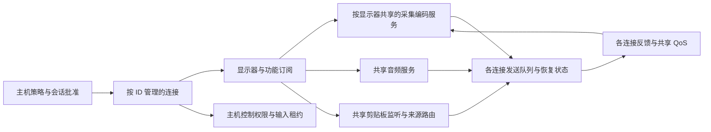

# 发射端与 RustDesk 的实现及效果对照（2026-11-07）

> **历史快照（2026-11-09 复核）**：本文件记录 11 月 7 日审查时的问题、源码行号和修复计划，F01–F04 已在当时完成。此后 v50–v61 已关闭 F05–F08 的结构性差距（按显示器共享采集编码、全订阅者 QoS、按连接 ID 管理、编解码能力协商），并补齐防休眠、GDI 兜底、文件分页、剪贴板方向、空目录、按需文件剪贴板、远程提权、主机入站录屏和 VP9 4:4:4。文中 H08/H11/H13/H15/H16/H18/H29–H33/H37 等行不代表当前状态。**当前功能矩阵和剩余差距以 [发射端模块对比](host-rustdesk-module-comparison-2026-11-08.md) 和 [当前状态与计划](status-and-plan-2026-11-09.md) 为准**；本文件只保留审查过程作为历史记录。

## 范围与结论

本轮的发射端指 Windows 被控主机：主机进程、服务、采集编码、媒体发送、输入执行、剪贴板、文件与专用会话。接收端只核查必要的协议配合与恢复反馈，不展开其界面、录制容器或跨平台功能；会合/中继/账号管理服务不在本轮修复排序内。

首次审查仅完成深入对照、修复顺序和效果验收标准；随后按“请修复问题”实施第一批 F01–F04。修复与验证见文末第七节；以下问题描述及源码行号保留审查快照，代码基线为 `f48c9bce2b9f020d5bec9b499799ce0140f37db9`。RustDesk 对照使用 **1.5.1** 的固定提交 `23e5bb471a040d62f0a6ad52591fb30784265b73`，延用全功能审查已取得的官方源码快照，不混用另一份工作目录或 nightly。官方文档快照为 `56f9310ca2c91f8e94b6a460290d1e94f62e0482`。

**最主要的差距是共享服务的组织方式和组合行为。** 当前虽然已有多观看者、独立权限、多屏入口和音频，但一个观看者仍持有整条桌面生产链；其他观看者只能跟随它。这使“首个会话的状态”影响其他会话的画面、音频和请求执行。RustDesk 以主机上的服务及其订阅者组织这些功能，显示器服务和连接管理具有独立身份。不能把“菜单存在”和“单会话可运行”视为完整对齐。

未进行 RustDesk/本项目的双机 A/B 测试，也未重跑会移动本机鼠标的 `host_multi`；新增固定画面回归与其他验证见第七节。下文审查结论区分：

- **代码确认**：执行分支或缺失入口已确认；涉及黑屏、延迟、听感的运行表现仍按触发条件描述。
- **效果待验**：代码具备路径，尚无本轮真实设备/网络的对测证据。
- **产品差异**：有意取舍或待补能力，不能直接当成缺陷。
- **工程建议**：建议的目标实现或验收门槛，不声称是 RustDesk 的实测成绩。

本项目现有 GPU 采集、GPU 转换和硬件编码约束继续成立。RustDesk 的 GDI/软件编码回退可作为可用性差异记录，但本轮不将其列为必须照搬的实现。

## 一、先修的实现问题

### F01 · P1：静止桌面下，关键帧请求没有独立执行机会

**触发条件**：首个观看者已连接，桌面完全静止；第二个观看者加入，或现有观看者请求关键帧恢复。

**当前路径**：跟随者加入后调用 `request_desktop_keyframe()`；生产者取出请求只设置 `force_keyframe`。DXGI 超时返回 `NoNewFrame`，共享采集器透传该结果，主循环直接 `continue`。已有缓存画面不会因关键帧请求被重新编码。因此，在持续没有桌面/光标更新的条件下，请求可能一直等不到执行。普通周期关键帧也经过同一分支。

依据：`src/host/host_server.cc:2363`、`:5464`、`:5584`；`src/capture/dxgi_capturer.cc:680`；`src/capture/shared_capturer.cc:91`。

**与 RustDesk 对照**：其服务有新订阅者 snapshot 机制，视频循环在无新画面时还有受限重复编码/静态刷新路径。静态刷新按编码器、画质设定预算，AV1 分支并不与 H.264/HEVC 相同；不能概括成所有编码器无限重发。参考 R02、R04。

**效果与证据边界**：可能出现“连接已成功，但画面要动一下才出现/恢复”。这不是本轮实机复现结论。现有 `tests/host_multi_test.cc:202` 的 `receive_frame_with_activity()` 会调用 `SetCursorPos` 制造画面事件，`:522` 正使用它验证跟随画面；所以该测试通过不能证明静止桌面加入正常。

**修复方向**：关键帧请求、订阅初始画面、静态质量刷新应能使用已验证的 GPU 缓存帧执行；区分“无新画面”和“无可编码缓存”，限制重复编码频率，桌面切换或权限失效时使旧缓存失效。不要通过移动鼠标解决生产问题。

**验收**：人工采集源只产出一帧，之后一直 `NoNewFrame`；第二个订阅者无需输入即可收到可解码关键帧；同样覆盖丢帧恢复、编码重建、静态桌面提高画质。首屏等待预算建议先设为 1 秒，属于项目目标。

### F02 · P1：跟随会话遗漏部分控制请求的处理

**代码确认**：`follow_shared_desktop()` 消费切屏、画质、隐私等请求并明确拒绝，但没有处理 `SetDisplayFollow`、`OsLoginRequest`、`SessionListRequest`、`SessionSelectRequest`。对应 QUIC 接收路径会把请求存入队列/待办字段，普通桌面主循环才调用相应 handler。`drain_peer()` 只处理输入观察及剪贴板，不会补做这些操作。

依据：`src/host/host_server.cc:2473`、`:5202`、`:5360`、`:5365`、`:7711`；`src/net/quic.cc:3226`、`:3480`、`:3523`、`:3557`。会话选择能力仍由 `src/host/host_server.cc:1136` 的服务配置授予，没有因跟随身份自动消失。

**效果**：在请求能合法发出的权限组合下，可能没有成功或失败结果，接收端只能等待自己的超时。尤其 Windows 会话列表仅需相应授权，并不要求持有输入控制权。

**对齐方向**：借鉴 RustDesk 的连接控制处理与媒体服务订阅分离（R01、R03）。先保证每一种会话都消费请求并返回 `Ok/Denied/Busy/Unsupported`；之后将真正的主机操作路由到共享管理器。不能简单把需要权限的操作全部放行。

**验收**：建立“会话模式 × 生产/跟随身份 × 已授权/未授权”的请求表；所有请求都有有界结果。测试 handler 用假 WTS/假登录接口，不能在自动测试中实际登录、切会话或重启。合并待办的请求还需明确最新请求覆盖前一请求的协议语义。

### F03 · P1：主机级配置关闭没有传播到所有已连接会话

**触发条件**：A、B 都已获文件/剪贴板等权限；A 有远程配置权限并关闭主机相应开关。

**当前路径**：修改 A 的 `settings_`，对 A 计算撤权，再把新设置写到 registry 给后续 worker 使用。`remote_settings_version` 只有写入/递增，没有活跃 worker 消费版本并应用设置的逻辑。B 保留旧 `settings_` 和权限。B 的配置查询却读取 registry 的新值，可能显示“已关闭”，实际文件或剪贴板入口仍使用旧值。

依据：`src/host/host_server.cc:223`、`:2024`、`:2606`、`:5913`、`:7623`、`:8383`。外层回调也没有重启全部 worker：`host/worker.cc:95` 仅保存设置，`host/main.cc:3803` 仅保存和刷新 UI。

**效果**：全局配置显示、当前会话能力和新会话能力不一致。此项是项目自身的一致性问题，不把 RustDesk 的全局配置热应用行为当作未经核查的保证。RustDesk 的按连接权限开关可用于参考明确的目标身份（R06）。

**修复方向**：将主机策略、一次批准的会话上限、当前授权分别表达；全局关闭传播到每个活跃会话和正在批准的连接，停止相关排队任务。重新开启策略不得自动授予之前未批准的能力。对 `allow_permission_change=false` 明确“仅下次生效”还是强制主机策略生效，并在结果中表达，不能返回无条件已生效。

**验收**：双会话并行传输时关闭文件/剪贴板；A、B 和新连接均符合明确的生效语义，查询与执行一致；撤权后旧异步结果不能重新写入或发出。通过假文件根、假剪贴板完成。

### F04 · P1：系统音频广播被生产会话的权限和发送结果截断

**触发条件**：主机允许音频，A 是画面生产者且没有音频权限，B 有音频权限；或 A 的发送队列暂时满而 B 正常。

**当前路径**：`drain_audio()` 先检查 A 的权限；A 无权限就取走并丢弃全部音频包。即使 A 有权限，也只有 A 的 `send_audio()` 成功后才执行 `broadcast_audio()`。B 自己的 `send_audio()` 确实会校验 B 的权限，但这不能弥补前面没有广播。

依据：`src/host/host_server.cc:3351`、`:3369`、`:3391`、`:7533`；`src/net/quic.cc:6879`。初始流描述使用采集到的音频格式，`announce()` 会重新按当前连接授权，所以该问题应与“音频是否宣告成功”分开测试。

**RustDesk 方式**：共享音频服务，连接通过各自的 `audio_enabled()` 订阅/退订，不由某个视频连接的许可决定全体数据来源（R01、R05）。

**修复方向**：采集生命周期由有效音频订阅者集合决定；每个订阅者独立授权和发送。A 的拒绝/拥塞不能阻止向 B 投递。保留 Opus 和现有 QUIC DATAGRAM 路径。

**验收**：四种 A/B 音频授权组合、连接顺序反转、A 队列满、A 离开、撤权恢复。假音频源验证包确实到达有权限者且不发给无权限者；AEC/真实听感另做双机测试。

### F05 · P1：只有一条全局桌面流，多窗口不等于独立多屏

**代码确认**：registry 只有一个 `desktop_publisher`、一份 `desktop_info` 和显示索引。后加入会话复制这份流描述；对它的切屏、显示模式查询/修改和画质修改分别返回 Busy/Failed。生产者退出后，某个跟随者重新创建采集和编码成为生产者。

依据：`src/host/host_server.cc:66`、`:2337`、`:2490`、`:2531`、`:2713`。`include/chast/host_server.h:11` 的“每观看者有独立 capturer/encoder”注释已过时。共享采集器按显示设备复用资源，不能据此推导上层已有按显示器独立的发布服务。

**RustDesk 方式**：按显示器创建视频服务，连接通过显示器集合添加、移除或替换订阅；同一连接也可订阅多个显示器（R01、R03）。它也共享编码及 QoS，不能据此承诺每个观看者任意独立码率。

**效果**：当前“逐屏开窗”的接收端入口不能证明主机能同时给不同窗口发送不同屏幕；后加入者的 Hello 显示选择不能覆盖共享描述。首个会话退出还会使所有跟随者经历生产链交接。

**修复方向**：按稳定显示器身份建立主机视频服务，资源生命期由订阅者决定；将生产者身份、输入控制租约、显示模式/隐私管理权限分开。选看哪块屏幕通常是订阅选择，修改物理分辨率/隐私拓扑仍是主机级动作。先兼容每连接一屏，后续如需减少连接名额消耗，再扩展一连接多流协议。

**验收**：A 看屏 1、B 看屏 2，A 切屏只改变 A 的订阅；同屏复用采集编码；任一订阅者退出不重建仍被使用的服务；负坐标、旋转、高 DPI、合并桌面、显示器热插拔分别验证。

### F06 · P1：拥塞策略围绕首个观看者，缺少媒体时效和全订阅者反馈

**当前路径**：视频先对生产会话调用可等待的 `send_frame()`，成功后才给跟随者 `send_frame_nowait()`。发送容量阈值是 32 MiB/4096 项，等待超时为 10 秒，容量状态跨该连接的发送共享。ABR 读取的也是生产会话的 `transport_stats()`；没有汇聚跟随者的反馈。32 MiB 是容量阈值，不是延迟预算，也不是保证绝不越过的严格单次总量上限。

依据：`src/host/host_server.cc:4038`、`:4896`、`:7514`；`src/net/quic.cc:48`、`:103`、`:4543`、`:6703`。

**效果**：生产会话堵塞可能阻止健康跟随者拿到后续画面，并延迟同一主循环内的音频、文件、控制请求处理；慢跟随者则可能积压/掉帧却不影响 ABR 决策。这里只确认等待及依赖关系，没有声称已测出 10 秒卡顿。鼠标键盘注入由 QUIC 接收路径提交给独立 `InputInjector`，不能笼统说“视频堵塞就一定阻塞全部输入”。

**RustDesk 方式与代价**：QoS 维护每个连接的延迟/FPS/画质，FPS 取保守值，画质使用最近的有效选择，编码帧带连接接收反馈；视频帧等待也有最多 3 秒的窗口。因此 RustDesk 同样可能受慢观看者影响，并非无阻塞、独立无限码率（R04）。

**修复方向**：发送与采集解耦；默认采用可解释的共享 QoS 决策，纳入全部订阅者。给媒体设置排队时间预算和关键帧恢复规则，区分可靠控制消息与过期视频。已经提交到可靠流的数据不能靠上层删除队列“撤回”，需在入队前限量，必要时定义流重建机制。跟随者掉帧已有序号缺口→请求关键帧路径（`app/windows/viewer/viewer_engine.cc:7725`），应补上发送侧等待可恢复帧的状态，而非宣称完全没有恢复。

**验收**：A 慢/B 快及 A 快/B 慢、同时大文件下载、丢包、带宽骤降再恢复；记录各连接队列字节/最老帧年龄、帧丢弃、关键帧恢复时间、控制请求结果时间、音频包间隔。明确共享降质策略后验收，不能要求共享编码在任何慢链路下都不影响快链路。

### F07 · P2：本地主机操作缺少明确的目标会话

**代码确认**：每次新会话准入都会改写 `registry_->focused`；主机公开的 `set_permissions()`、聊天、发文件等操作转给该 focused 会话。当前没有按 session id 选择目标的公开接口。多个会话的状态和操作容易被“最近连接者”主导。

依据：`src/host/host_server.cc:1452`、`:1460`、`:1495`、`:1517`、`:2186`；主机 UI 在 `host/main.cc:3243` 等处调用无目标参数的权限接口。RustDesk 的连接管理器以连接 id 操作权限和关闭连接（R06）。

**修复方向/验收**：提供可选择的连接列表、稳定会话 id 和显式目标操作；两人同时在线时，管理员能仅撤销 A 的剪贴板、回复 B 的聊天、断开 A，B 不受影响。保留独占输入租约，但显示持有人并提供明确的交接结果。

### F08 · P2：编码格式是主机选择，缺少接收能力交集

本机有 H.264/HEVC/AV1 硬件编码选择与硬件后端尝试，不能标为“没有硬件回退”。但 `ClientHello` 的能力位仅有音频 datagram，没有视频解码格式/色度能力；当前是主机宣告实际编码、接收端随后创建解码器。跟随者也不能修改编码选项。

依据：`include/chast/protocol.h:1328`；`src/codec/encoder_factory.cc:57`；`src/host/host_server.cc:2531`。RustDesk 维护 `supported_decoding` 与协商编码状态（R07）。

**效果待验**：主机选 HEVC/AV1 而某接收设备没有对应硬件解码时，缺少连接前协商出的兼容格式保证。修复应以主机能力和所有订阅者实际能力交集选择共享编码；无交集时明确拒绝该订阅或说明需要其他服务配置。不要以增加 CPU 解码作为本轮默认方案。

**验收**：H.264-only、HEVC-capable、AV1-capable 三种假能力组合，先后加入顺序不同得到一致的可解释结果；格式变化带新描述与关键帧，失败保持原有可用会话。

## 二、发射端功能、方式、效果矩阵

“有路径”仅表示实现存在；效果列是需要达到或确认的行为。P 表示本项目代码，R 表示文末 RustDesk 证据索引。

| ID | 主机能力 | RustDesk 方式 | 本项目方式与判断 | 效果验收/修复关联 |
| --- | --- | --- | --- | --- |
| H01 | 安装服务、开机常驻 | Windows 后台服务与桌面会话进程 | **有路径**：SYSTEM 服务启动会话 worker，另有托盘/便携主机；P01、R10 | 重启、注销再登录、服务恢复后仍可连接；包级测试待验 |
| H02 | 便携运行、会话内提权 | 请求提权/接受并提权、portable service；R10 | **部分**：有便携运行，无会话内提权流程 | 临时支持中遇 UAC 不应误报普通会话已能操作；提权是独立后续工作 |
| H03 | 直连、代理/中继接入 | 客户端参与多种连接路径；R10 | **有路径/实现不同**：本地主机 QUIC，TCP/WS 载体和隧道代理；P02 | 防火墙限制、公网 NAT、路径失败后重连；本轮不评价中央服务功能 |
| H04 | 无人值守与本地审批 | 密码/审批、会话授权；R03、R10 | **有路径**：密码、审批、Both、独立权限；P03 | 错误密码不能变成自动转审批绕过；拒绝有结果和审计 |
| H05 | 可信设备、2FA、IP 限制 | 对应安全设置；R10 | **有路径**：签名设备、TOTP、期限、IPv4/IPv6 CIDR；P03 | 到期/撤销/重放/代理来源判断单独验收，不扩成账号 ACL 比对 |
| H06 | 多连接与控制权 | 连接表与服务订阅；R01、R06 | **部分**：默认 2、上限 8，输入独占；媒体依附首会话；P04 | F04–F07；选择目标、控制权与生产资源解耦 |
| H07 | 会话内权限和全局策略 | 按连接权限操作；R06 | **部分**：有 live 权限，主机策略传播不完整；P04 | F03；可查询的设置必须与实际执行一致 |
| H08 | 活跃会话、防休眠 | 依据入站连接数持有 wakelock；R08 | **已有实现**：`keep_awake`（默认开）为每个已认证会话创建独立 `PowerRequest`，桌面会话加显示请求，结束即释放；P01、P05 | 无输入观看/传文件期间按配置保持唤醒，最后连接结束释放；真实睡眠策略验收 |
| H09 | 单屏、合并桌面 | 按显示器服务、显示器订阅集合；R01、R03 | **有路径**：DXGI 单屏及合并采集；P06 | 跨 GPU、旋转、负坐标与尺寸上限需真机验证 |
| H10 | 不同观看者独立选屏 | 连接的显示器订阅不同；R03 | **已对齐/已验证**：每连接按稳定显示器身份订阅（`src/host/host_server.cc:2573`），同屏共享采集编码；`chast-host-parity-test` 覆盖 A/B 独立选屏、切换互不影响、同目标复用流水线；P04 | 真实双显示器 A/B 同看不同屏、热插拔；F05 审查过程见前文快照 |
| H11 | 远程分辨率/跟随窗口 | 显示模式与跟随订阅；R03 | **部分**：生产者有模式修改、跟随逻辑，跟随者限制/漏处理；P04 | F02/F05；区分选看屏幕与改变物理模式 |
| H12 | 无头与虚拟显示器 | Windows 虚拟显示集成；R10 | **部分/待验**：usbmmidd、安装检查、拓扑守卫；通用 vdd 未实现；P07 | 无物理屏、驱动不可用、异常退出恢复；不能把 provider 名称视为可用性证明 |
| H13 | 隐私与本地输入屏蔽 | 隐私服务与恢复逻辑；R10 | **有路径/组合有限**：遮罩/虚拟屏、BlockInput，跟随者拒绝；P07、P04 | 撤权/断线/进程崩溃后恢复拓扑及本地输入；按控制权而非生产身份管理 |
| H14 | 安全桌面、锁屏/UAC | 服务/桌面切换和输入执行；R10 | **有路径/待验**：服务 worker、desktop follow、SAS；托盘能力有限；P01、P08 | 安全桌面进出、显示器变化不中断可用会话；便携限制明确 |
| H15 | 硬件编码与协商 | 硬件/软件能力协商；R07 | **部分**：GPU H.264/HEVC/AV1、oneVPL/FFmpeg 硬件后端；无视频能力交集；P09 | F08；保持硬件路径，测不同 GPU 的共同可用格式 |
| H16 | 文字清晰度/真彩色 | 可选 I444；R07、R10 | **差异**：BGRA→NV12 4:2:0；无 I444；P06 | 小字号彩色文字/细线图的截图对比；码率提高不能等价恢复色度采样 |
| H17 | HDR | 平台相关采集、色彩转换；R10 | **有限实现**：FP16 归一为 BGRA8/NV12；P06 | 高光/暗部、SDR/HDR 混屏、色彩切换；不宣称 HDR10 端到端 |
| H18 | 采集/编码故障恢复 | DXGI 有限重试，GDI/VP9 回退；R04 | **取舍+待验**：GPU 重建、后端尝试，无 GDI/CPU 回退；P06、P09 | 驱动重置、热插拔、RDP 进出；先完善 GPU 内恢复、明确失败状态 |
| H19 | 静态桌面首帧/质量刷新 | snapshot、受限重复编码；R02、R04 | **已对齐/待实测**：F01 关键帧待办可重复编码，F10 指针唤醒不产生视频帧；静态刷新预算按真实桌面更新重置；P04 | 无需移动鼠标即可加入/恢复；真实双机静止画质、空闲占用与长期预算消耗待测 |
| H20 | 光标形状与位置 | cursor/position/window focus 独立服务；R01 | **已对齐/已验证**：指针在显示采集线程内、编码之前经每订阅 sink 直接投递（`src/host/desktop_stream.cc:225`、`src/host/host_server.cc:154` 的 `CursorPublisher`），33 ms 节流、独立光标消息；视频队列全满时采样不停，指针唤醒不产视频帧；P04 | 500 kbps 拥塞下视频帧年龄 3553 ms 时光标仍 291 次/0 丢弃；真实双机高延迟/丢包的节拍与坐标精度待验 |
| H21 | 自适应码率/FPS/分辨率 | 多用户 QoS 和帧反馈；R04 | **基本对齐**：所有观看者参与同一 `VideoQos`（FPS 取最小上限、延迟/取帧反馈、画质投票），共享源按聚合结果调码率/FPS/比例；P10 | F06；不同屏共享同一 FPS 决策，慢屏会拉低其他屏；记录所有观看者时延与队列年龄 |
| H22 | 系统声音 | 主机音频服务按连接订阅；R05 | **单会话有路径，多会话有缺陷**：WASAPI/Opus/datagram，广播依附生产者；P11 | F04；授权组合、设备热插拔、静音恢复 |
| H23 | 麦克风/语音通话 | 通话协商与音频设备切换；R03、R05 | **有路径/待验**：独立上行、呼叫流程、AEC/静音门；观看端麦克风设备可选，主机语音麦克风可在设置/托盘选择，缺失设备回退默认通信设备（2026-11-11，G22）；P11 | 双机对讲、扬声器回声、多连接竞争与真实设备切换，不能用包传递测试代替听感 |
| H24 | 摄像头 | 摄像头视频服务及独立连接；R01 | **有路径/待验**：CameraRelay，独立/桌面内会话；P12 | 相机占用、拔插、权限撤销和多会话设备争用 |
| H25 | 默认键盘、修饰键、释放 | Map/Legacy/Translate、独立输入处理；R09 | **默认 Map 方向一致**：HID→扫描码、Unicode 文本、释放屏障、6 分钟卡键清理；P08 | 已有默认模式工作应保留；不同布局/AltGr/失焦/断线验收 |
| H26 | Translate/本地 IME | 按模式处理按键和字符；R09 | **缺少完整模式**：主机能注入文本，但协议/控制端转换不能仅靠主机补齐 | 后续定义端到端输入语义；不把“发送文本”当成 Translate 完成 |
| H27 | 鼠标、触摸、笔 | 平台输入注入；R09 | **有路径/待验**：相对鼠标、滚轮、多触点/压感；无 UI 进程已改为逐显示器 DPI 感知（F09）；P08 | 负坐标、高 DPI、触控板、压感真实设备，长按后撤权全部释放 |
| H28 | SAS、重启、锁屏、登录、WTS | 权限检查后的连接控制请求；R03、R10 | **部分**：单生产会话已实现；跟随会话拒绝或遗漏，OS 登录仅密码输入；P04、P01 | F02；假平台接口验证请求完成，真实系统动作另做受控验收 |
| H29 | 多格式剪贴板 | 全局 listener、订阅者；R11 | **有路径/方式不同**：各会话异步 worker，500ms 轮询；P13 | 来源路由、延迟、阻塞调用、撤权恢复、多个远端同时复制 |
| H30 | 文件剪贴板/复制粘贴 | Windows IDataObject/FILECONTENTS 按需内容请求；R11 | **部分**：立即暂存传输，完成后 CF_HDROP；限 256 普通文件，空目录不能完整表示；P13 | 仅复制未粘贴不应无谓搬大文件；空目录、取消、源文件变化 |
| H31 | 单向剪贴板/单向文件 | 独立方向限制选项；R03、R10 | **缺失**：Clipboard/FileTransfer 只有总权限；剪贴板文件走 Clipboard 权限；P14 | 上传允许/下载拒绝及反向；普通文件和剪贴板文件都必须覆盖 |
| H32 | 文件系统浏览 | 盘符、隐藏项、目录/任务；R12 | **有限范围**：共享根、reparse 防护，1024 条截断，无续页；P14 | 万条目录全部可达；多根授权单独设计，不能直接放开绝对路径 |
| H33 | 文件传输与目录操作 | 续传、目录任务、压缩块；R12 | **部分**：上传/下载/目录队列/续传/取消已有；16GiB 上限，删除限文件/空目录，无压缩；P14 | 文件校验、空目录、断网续传、并发视频时延；列表截断不能导致静默漏文件 |
| H34 | 终端与持久终端 | 终端会话管理；R10 | **有路径/有限额**：ConPTY、持久服务、重连回放；P12 | SYSTEM/用户上下文明确，撤权、断线、重连与回放边界 |
| H35 | TCP 转发/RDP 目标 | TCP tunnel；R10 | **有路径**：PortForwardRelay，目标限制和配额；P12 | 拒绝目标、半关闭、断线清理；不新增通用 VPN 需求 |
| H36 | 本地聊天/连接管理 | 按连接 id 管理聊天/权限；R06 | **部分**：聊天有路径，本地操作默认最近准入连接；P04 | F07；收到消息与回复目标不能混淆 |
| H37 | 主机自动录制 | 入站 video service 的 recorder；R04、R10 | **缺失**：allow_record 只是允许查看器录制，主机未接入录制器；P05 | 主机配置启用即可留档，编码/尺寸变化分段、磁盘满策略与告知 |
| H38 | 审计与断开清理 | 连接日志及资源管理；R03、R06 | **有路径**：主机本地 spool、按会话记录、last-viewer 锁屏；P15 | 多人退出顺序、异常断线、审计身份唯一；不等于录屏 |
| H39 | 远程打印、角色互换 | 打印服务、Switch Sides；R10 | **缺失/后续产品项**：需双端协议和部署支持 | 不作为第一批主机稳定性修复 |
| H40 | Linux/macOS/移动被控端 | 分平台实现，iOS 不能被控；R10 | **范围取舍**：当前 Windows 主机 | 本轮不将跨平台移植混入 Windows 发射端对齐 |

## 三、建议的目标组织方式

以下是结合当前代码的目标拆分，不要求重写为 Rust，也不要求改用 RustDesk 网络协议：



`HostServer` 当前同时承担连接、视频生产、广播、多个控制循环、文件和音频调度；同一请求要在生产、跟随、文件、控制专用循环中分别维护，F02 就出现在这些分支之间。建议先抽出完整的请求分派与权限应用，再分离媒体服务，逐步迁移，避免一次性大改后无法定位效果退化。

共享采集本身还有应量测的成本：`src/capture/shared_capturer.cc:82` 在 source 锁内执行采集、跨设备复制和转换，`:43` 的 GPU event 等待有 2 秒截止时间。它仍是 GPU 路径，但“无 CPU 像素拷贝”并不意味着没有 GPU 拷贝或 CPU 等待。本轮未量测其常态耗时；在增加按屏服务前后应记录锁持有时间、GPU 等待和带宽，而不是据此直接宣称性能有问题。

## 四、修复顺序与可交付边界

| 批次 | 工作 | 依赖与边界 | 完成标准 |
| --- | --- | --- | --- |
| 1A · P1 | F02 请求完整处理；F03 策略传播 | 先建立假平台/假剪贴板/临时文件根的双会话回归，不实际执行危险系统动作 | 所有模式都有明确结果；全局设置、已有授权和新连接的行为一致 |
| 1B · P1 | F01 静态首帧；F04 音频广播 | 可以在当前架构中先修，不必等待全面拆分；保留 GPU/Opus 路径 | 完全静止也能加入/恢复；A 无音频权限不影响 B 收音 |
| 2A · P1 | F05 按显示器服务；F07 按 ID 管理会话 | 先明确订阅、生产资源与控制权三个身份，兼容现有单流连接 | 不同连接独立选屏、同屏复用；关闭某连接不重建别人的流 |
| 2B · P1 | F06 全订阅者反馈、发送时效和故障隔离 | 接在共享服务边界上，先确定共享降质的产品规则；接收端只做必要反馈配合 | 弱网矩阵中队列受控、恢复可解释；控制和音频不跟着 10 秒容量等待停摆 |
| 2C · P2 | F08 编码能力协商，静态质量策略 | 与共享编码分组、1B 缓存帧机制配合 | 异构 GPU 组合可连接或明确拒绝；静态文字对照可复现 |
| 3A · P1/P2 | H31 单向权限；H29 事件监听与来源路由；H32 大目录分页 | 先定义方向与来源语义，再改事件驱动；分页保留根目录安全校验 | 数据流向可控、多会话无意外反向同步、万条目录可完整访问 |
| 3B · P2 | H30 按需文件剪贴板、空目录；H33 文件工作流补齐 | 需协议和两端配合；普通文件浏览与剪贴板文件一起验收 | 未粘贴不全量搬运，取消/恢复/源变化不留下错误文件 |
| 4 · P2 | H08 防休眠；H02 便携提权；H37 主机录制 | 三个可独立拆分的小里程碑；防休眠可提前并行，提权和录制有 UI/部署依赖 | 以配置驱动并有可见结果，退出/异常清理明确 |
| 5 · 决策项 | H16 I444、其他平台、打印、Switch Sides | 保留硬件和平台边界，分别做技术/产品决策 | 不用“全功能对齐”暗示这些已交付或已有性能保证 |

第一批建议先完成 **F02/F03/F01/F04**。它们是已有能力的闭环问题，触发条件清楚，能分别交付回归证据。F05/F06 需要共享服务结构调整，单独成批，避免把重构与首批修复混在一起。

## 五、效果验收方法

先用可控输入建立回归，再在同一组主机/接收机上对照 RustDesk；不要用不同分辨率、不同编码器或不同网络下的单次 FPS 推导优劣。

| 场景 | 必须观察的结果 | 证据级别/条件 |
| --- | --- | --- |
| 一帧后永久静止，后加入观看者 | 首个可解码关键帧时间、是否需要鼠标活动 | 假采集/假编码验证状态机；真 GPU 补验 |
| 跟随者逐项发送控制请求 | 每项结果码、完成时限、无遗留待办 | 假 OS/WTS 接口；覆盖合法/拒绝/不支持 |
| 两会话的音频四种权限组合 | 每连接实际收到的包、撤权后为零、恢复后的序号/时序 | 假音频；之后双机扬声器听感 |
| 主机全局关闭文件/剪贴板 | 所有活跃会话与新连接行为、旧异步任务清理 | 临时文件根/假剪贴板 |
| 两屏两连接、同屏两连接 | 独立选屏、采集编码实例数、断开是否重建 | 逻辑回归后双显示器真机 |
| A 慢/B 快，连接顺序互换 | 逐连接帧年龄、队列、共享画质、控制回复和音频间隔 | 网络限速/丢包环境；保持相同编码参数 |
| 动态画面停止为彩色小字 | 1/2/5 秒截图、文字细节、空闲带宽/GPU 占用 | 固定桌面图、100% 显示比例，避免缩放掩盖差异 |
| GPU reset、屏幕热拔插、RDP/锁屏切换 | 恢复时长、状态提示、输入释放、旧帧是否被错误重用 | 专用 Windows 测试机，安装服务模式与便携分开 |
| 多观看者同时复制、多格式和大文件 | 来源、循环次数、首次同步语义、按需流量、空目录完整性 | 假后端回归；Office/Explorer 真实互操作另验 |
| 10,000 条目录，含目录和重名变化 | 全量可达、续页稳定性、下载不漏项、根外路径拒绝 | 临时文件根 |
| 长时间无输入的观看/文件传输 | 是否保持系统唤醒，退出后是否恢复原策略 | 专用电源策略测试，不能依赖视频刷新等同于唤醒 |
| 主机录制、磁盘满、编码/尺寸切换 | 可播放分段、错误可见、会话控制不受磁盘阻塞 | 实现录制后再执行 |

统一记录版本、GPU/驱动、OS、显示器拓扑、编解码格式、FPS/画质、音频配置、连接路径和网络参数。效果指标至少包括首屏、控制请求往返、画面年龄 P50/P95、丢帧恢复、静态画质、音频间隔与掉包、CPU/GPU/显存、空闲/动态带宽。建议首屏和控制请求先设置明确的实验预算，但最终通过值应由基线 A/B 决定，本报告不填造测试成绩。

## 六、证据索引与现有测试的含义

本项目路径相对仓库根目录。RustDesk 路径相对固定快照目录：

`build/review/full-parity-2026-11-07/client/rustdesk-23e5bb471a040d62f0a6ad52591fb30784265b73/`

文档路径相对 `build/review/full-parity-2026-11-07/docs-api/`。这些审查下载物被 `build/` 忽略，不随文档提交；用上面的官方提交可重新取得。下列源码和文档可复核本轮判断，不依赖可变的 master 分支。

| 索引 | 来源与入口 |
| --- | --- |
| P01 | `host/service.cc`、`host/worker.cc:398`、`host/platform.cc`、`host/main.cc` |
| P02 | `src/host/host_server.cc:1116`、`host/tunnel.cc`、`src/net/carrier.cc` |
| P03 | `include/chast/host_security.h:1`、`src/host/host_security.cc`、`include/chast/host_settings.h:61` |
| P04 | `src/host/host_server.cc:49`、`:2231`、`:2267`、`:2754`；`include/chast/host_server.h` |
| P05 | `include/chast/host_settings.h:100`；对 `host/`、`src/`、`include/`、`app/` 检索电源 API/keep-awake，未找到主机防休眠实现 |
| P06 | `src/capture/dxgi_capturer.cc`、`src/capture/merged_capturer.cc`、`src/capture/shared_capturer.cc`、`src/capture/hdr_pass.cc`、`src/capture/nv12_pass.cc` |
| P07 | `src/host/virtual_display.cc`、`src/host/display_privacy.cc`、`src/win/privacy.cc`、`host/display_guard_main.cc` |
| P08 | `src/win/input.cc:481`、`:1252`、`src/win/desktop.cc`、`src/win/sas.cc`、`src/net/quic.cc:2933` |
| P09 | `src/codec/encoder_factory.cc:45`、`src/codec/ffmpeg_encoder.cc`、`include/chast/protocol.h:1328` |
| P10 | `src/host/bitrate_controller.cc`、`include/chast/bitrate_controller.h`、`src/net/quic.cc:4531` |
| P11 | `src/audio/wasapi_capture.cc`、`src/audio/wasapi_mic.cc`、`src/audio/audio_dsp.cc`、`src/host/host_server.cc:3347`、`:7916`、`:8080` |
| P12 | `src/host/camera_relay.cc`、`src/host/terminal_relay.cc`、`src/host/port_forward_relay.cc`、`include/chast/protocol.h:1055` |
| P13 | `src/clipboard/clipboard_worker.cc`、`src/clipboard/clipboard.cc:495`、`include/chast/clipboard.h:45`、`src/host/host_server.cc:7669`、`:7751` |
| P14 | `src/clipboard/file_transfer.cc:702`、`:775`、`include/chast/protocol.h:637`、`:645`、`:706`、`:750`、`:1016` |
| P15 | `src/host/audit_spool.cc`、`src/host/host_server.cc:2202` |
| R01 | `src/server.rs:115`、`:138`、`:447`、`:469`、`:520`：连接表、音频、按屏视频、订阅 |
| R02 | `src/server/service.rs:107`、`:191`、`:224`、`:255`、`:301`：订阅快照、共享消息、服务线程 |
| R03 | `src/server/connection.rs:2352`、`:2363`、`:2752`、`:3906`、`:4713`、`:4955`、`:6252`：权限、模式、显示器订阅与文件方向 |
| R04 | `src/server/video_service.rs:645`、`:655`、`:870`、`:933`、`:1009`；`src/server/video_service/static_refresh.rs:32`；`src/server/video_qos.rs:463`、`:667`、`:677`、`:731`、`:818` |
| R05 | `src/server/audio_service.rs`、`src/server/connection.rs:836`、`:2363`、`:5004`：共享音频与逐连接开关 |
| R06 | `src/ui_cm_interface.rs:408`；`flutter/lib/desktop/pages/server_page.dart:186`、`:706`、`:1198`：连接列表、目标权限、断开 |
| R07 | `libs/scrap/src/common/codec.rs:171`、`:327`、`:403`、`:424`；`src/server/connection.rs:2752`、`:5753`：格式/色度能力及协商 |
| R08 | `src/server/connection.rs:6681`；`src/platform/windows.rs:3262`：入站连接 wakelock 与 Windows 电源请求 |
| R09 | `src/client.rs:3725`；`src/server/input_service.rs:932`、`:1020`、`:1581`；`flutter/lib/desktop/widgets/remote_toolbar.dart:2615`：默认 Map、输入执行与清理、可选模式 |
| R10 | `content/client/_index.en.md`；`content/client/windows/windows-portable-elevation/_index.en.md`；`content/self-host/client-configuration/advanced-settings/_index.en.md`（自动录制、防休眠、I444、单向权限等）；`src/server/printer_service.rs`、`src/server/connection.rs` |
| R11 | `src/clipboard.rs:889`、`:1029`；`libs/clipboard/src/windows/wf_cliprdr.c:1031`、`:2099`、`:2162`：共享监听、IDataObject、FILECONTENTS |
| R12 | `libs/base/src/fs.rs:53`、`:905`、`:1106`；`libs/base/protos/message.proto:409`：盘符、传输块与文件操作 |

现有 `tests/host_multi_test.cc` 覆盖多人准入、名额、审计引用、控制租约和生产者退出后的接管；其中桌面段既有硬件条件跳过，也会主动移动光标，因此不覆盖 F01 的静止场景。`tests/host_voice_test.cc` 用假麦克风验证语音流程，不代表已验证 F04 的两观看者系统音频权限组合。`tests/host_control_test.cc`、`tests/clipboard_async_test.cc` 的慢剪贴板/撤权回归也不能代替 F03 的全局策略跨会话传播。

首次审查新增的是审查文档和对旧矩阵的限定修正。已检查 40 个连续能力编号、8 个重点问题、182 处源码路径/行号引用（含省略文件名的续引）、两份既有文档的索引和 diff 空白；检查通过。未运行产品测试或真实桌面操作。产品测试结果仍沿用各次运行的原始记录，不能把“此前测试通过”改写为“本轮已验证效果等同 RustDesk”。


## 七、第一批修复记录（2026-11-07）

F01–F04 已实现并通过自动化回归。前文的触发条件、源码行号和差异矩阵为修复前审查快照；当前状态以本节为准。F05–F08 仍待后续批次。

| 问题 | 本轮结果 | 验证与边界 |
| --- | --- | --- |
| F01 静态关键帧 | 持有有效 NV12 纹理的 COM 引用；NoNewFrame 遇关键帧请求时重复编码，不支持 repeat 时重新导入缓存纹理。重建/切屏/转换失败后清除缓存；无请求不持续编码。 | 固定一帧后永久静止，后加入者及主动请求均得到 IDR；验证 repeat 回退、重建期间不发送旧桌面。另修建连期间桌面切换后使用失效首帧/编码器。真实 GPU 完全静止双机首屏时延待测。 |
| F02 请求完成 | 跟随会话处理显示跟随、OS 登录、WTS 列表/选择；保留输入权限、控制租约和目标校验。文件/控制模式明确拒绝不适用的桌面选项。 | 假登录/WTS 验证成功、Unsupported、Busy、NotFound、Failed。未真实锁屏、登录或切换 WTS；跟随者独立选屏、改流参数和主机动作的既有限制仍待后续架构工作。 |
| F03 全局策略 | 共享原子策略限制传输；对已注册会话（含待审批）撤销原始授权；各工作线程同步设置、清理资源并通知。全局关闭不受 UI 权限冻结限制；重新开启不自动恢复旧授权。新连接读取更新后的安全默认值。 | 桌面、跟随、文件、终端全部撤权；覆盖普通/冻结权限、禁用时拒绝新文件连接、重新启用的新连接、审批期间 off/on。窄范围 setter 保留密码、临时密码和锁定计数等安全状态。 |
| F04 音频独立性 | 先向跟随者分发，各连接独立检查权限；发布者静音或发送失败不关闭共享源。共享描述保留音源格式，恢复权限刷新描述；需要时补开音频流，由全局关闭切到开启时建立音源。 | 覆盖两接收者四种音频授权组合、撤权/恢复、发布者离开后的接替、连接后开启音源；合成 Opus 包验证传输。真实听感、热插拔和拥塞效果仍待测。 |

同时补全 HelloAck/StreamInfo 中 RemoteConfig 的既有掩码位序列化/解析，以及客户端还原 SessionSelect、RemoteConfig 权限。未新增线格式字段，仍使用 v49 的既有 u32 权限掩码。

新增 `tests/host_media_stub.h`、`tests/host_parity_test.cc`：真实回环 QUIC，固定画面、可计数编码器、具备 COM 生命周期的假纹理、合成系统音频、假剪贴板、临时文件根及假登录/WTS。生产默认仍使用 DXGI、GPU 转换与硬件编码。原有控制/登录测试启用 dry-run 输入，语音测试补齐空剪贴板接口。

验证命令：

```powershell
cmake --build build/root --config Release --target chast-host-parity-test chast-protocol-test chast-host-security-test chast-host-control-test chast-host-login-test chast-host-voice-test chast-host chast-service chast-viewer-probe
ctest --test-dir build/root -C Release -R '^(protocol|host_parity|host_security|host_control|host_login|host_voice)$' --output-on-failure
git diff --check
```

串行测试 **6/6 通过，26.54 秒**：protocol 0.07s、host_parity 9.97s、host_voice 2.02s、host_control 8.12s、host_login 2.25s、host_security 3.94s。七个 host_parity 场景全部通过；原有语音/控制/登录用例实际使用 2560×1440 oneVPL VDENC AVC，未跳过。主机、Windows 服务、原生查看器探针构建通过。构建仍有现有 CRT 链接冲突/未使用 DELAYLOAD 等警告，不声称零警告。日志位于本地 `build/root/Testing/Temporary/LastTest.log`，构建产物不提交。

## 八、第二批修复记录（2026-11-10）

### F09 · P1：缩放显示器上绝对鼠标/触摸/笔坐标落在错误位置

RustDesk 在进程入口调用 `SetProcessDpiAwareness(2)`（`src/main.rs:23`），使 Win32 坐标 API 与 DXGI 输出矩形同处物理像素空间。本项目此前只有托盘
`host/main.cc` 调用了 `SetProcessDPIAware()`（系统级）；真正承担会话采集与输入注入的服务 worker（`host/service_main.cc` 的 `--worker`）
和 `chast-quic` 工具完全没有声明 DPI 感知。在缩放比例非 100% 的显示器上，这些进程的
`GetSystemMetrics(SM_*VIRTUALSCREEN)`（`src/win/input.cc` 的绝对移动、触摸与笔映射）、`GetCursorPos`、`GetMonitorInfoW`
被 Windows 虚拟化为逻辑像素，而 DXGI 显示矩形（`src/capture/display.cc`）和查看器发送的虚拟桌面坐标都是物理像素。结果是：
绝对鼠标、触摸、笔点击按缩放比例偏移；`foreground_display_index` 可能选错显示器。

修复（不引入 RustDesk 代码，仅对齐进程声明）：

| 位置 | 变更 |
| --- | --- |
| `include/chast/desktop.h`、`src/win/desktop.cc` | 新增 `enable_physical_desktop_coordinates()`：先 `SetProcessDpiAwareness(PROCESS_PER_MONITOR_DPI_AWARE)`，失败时回退 `SetProcessDPIAware()`，最后用 `GetProcessDpiAwareness` 返回有效状态，不轻信调用返回值 |
| `host/service_main.cc` | `wmain` 入口最先调用，`--run`/`--worker` 两条路径都覆盖；worker 无 UI，物理像素坐标始终正确 |
| `tools/quic.cc` | `main` 入口调用；`verify` 与 `serve` 共用真实 `HostServer` 采集/注入路径 |
| `CMakeLists.txt` | `chast.net` 链接 `shcore`（`SetProcessDpiAwareness`/`GetProcessDpiAwareness`） |
| `tests/desktop_test.cc` | 断言调用成功且 `GetProcessDpiAwareness` 实际为逐显示器感知 |

边界与验证：

- 托盘主机仍保持系统级感知：其 UI 按主屏 `LOGPIXELSX` 固定布局，直接升级为逐显示器感知需要补 `WM_DPICHANGED` 布局重排，否则会引入界面回归。因此便携模式在混合 DPI 的非主屏上仍可能偏移，这是已知限制，不是已修复项。
- 本机为单屏 1920×1080、缩放 100%（AppliedDPI=96），无法在本机复现缩放偏移效果。已完成的验证是：Release 构建通过；`desktop` ctest 通过（含新增的两条感知断言，0.02 s）；`chast-service --help` 与 `chast-quic` 启动正常；真实 `quic_stream_options` 回环（实际采集/编码/解码）40.07 s 通过。
- 仍需在 125%/150% 缩放的真实显示器上做双机验收：远端光标落点、触摸/笔映射、前台窗口所在屏选择。在该验收完成前，不宣称高 DPI 效果已与 RustDesk 等同。

### F10 · P1：指针唤醒被当成桌面帧，静止桌面上的每次鼠标移动都触发视频编码

RustDesk 的 DXGI 复制在 `AccumulatedFrames == 0 || LastPresentTime == 0`（只有指针更新）时返回
`WouldBlock`（`libs/scrap/src/win/dxgi/mod.rs`），使指针唤醒根本不进入视频发送路径；光标由
`input_service.rs` 中约 33 ms 的 `new_cursor()`/`new_pos()` 服务独立发布。本项目此前在两层都把指针唤醒
当成新桌面：共享采集对每次唤醒都复制 GPU 表面并重新做 NV12 转换，`DesktopStreamPool::Source::pump`
随即编码一个完整视频帧；主机空闲时又每约 5 ms 轮询一次光标，指针移动会把控制队列灌满
`CursorUpdate`。效果是静止桌面上移动鼠标持续产生视频帧、抬高编码占用，并把刷新预算当成运动消耗。

修复（仅参考行为与字段语义，不引入 RustDesk 代码）：

| 位置 | 变更 |
| --- | --- |
| `src/capture/shared_capturer.cc` | 指针专用唤醒返回 `desktop_updated=false`、`nv12_updated=false` 的帧，复用已缓存纹理与共享句柄，跳过 `CopyResource` 和 NV12 转换；光标/序列号作为源元数据独立更新，读者仍能观察到最新指针 |
| `src/host/desktop_stream.cc` | `Source::pump` 只在真实桌面更新时编码；指针采样只刷新元数据，不再编码，也不重置静态刷新预算（真实桌面更新才重置）；待处理的关键帧和静态质量刷新仍会被服务 |
| `src/host/host_server.cc` | `publish_cursor` 增加 33 ms 节流（`DesktopVideo::cursor_sent_at`），对齐 RustDesk 光标服务节拍，避免空闲 5 ms 轮询把每次指针变化都发成控制消息 |
| `tests/desktop_stream_test.cc` | 新增 `cursor_only_wake`：指针移动后订阅者能在 1 s 内看到新坐标，且静止桌面不增加任何 `encodes`；同时修正大用例重置循环，改用 `discard_backlog` 丢弃旧代图片，消除与 `generation` 递增竞争的偶发失败 |

边界与验证：

- `desktop_stream` ctest 连续 5 次通过；`desktop`、`host_parity`（170.4 s）、`video_qos`、`cursor`、`remote_cursor` 通过；真实共享采集工具 6/6 通过。
- 真实路径对照（`chast-quic verify --port 45683/45684 --seconds 8`，真实 DXGI 采集与硬件编码，全屏黑窗口制造静止桌面）：
  - 真实光标以约 8 ms 步进移动：`frames=120 encoded=119 pointer-only=118 repeats=127`，`cursor sent=223 shapes=1 dropped=0 errors=0`。
  - 同一静止桌面不移动光标：`frames=119 encoded=119 pointer-only=117 repeats=117`，`cursor sent=1`。
  - 两次的视频访问单元完全相同（119），变化只有光标消息数；指针事件没有换算成任何额外视频帧。光标约 26 次/秒，与 33 ms 节拍一致；动画桌面基线为 `frames=148 encoded=147 pointer-only=0 repeats=3`。
- F10 已解决“指针唤醒不产视频帧”，但采样仍在会话循环内；该剩余部分由下一节关闭。

### F10 补充（2026-11-10）· P1：光标投递从会话循环移到显示采集线程

RustDesk 约 33 ms 的光标服务（`input_service.rs` 的 `new_cursor()`/`new_pos()`）独立于视频编码和发送队列。此前本项目的光标采样挂在主机会话循环上：视频编码慢、发送队列满或会话忙于其他消息时，光标消息会一起被推迟。现改为每订阅一条从采集线程直达发送层的路径。

修复（仅参考行为与字段语义）：

| 位置 | 变更 |
| --- | --- |
| `src/host/desktop_stream.cc` | 每个 `Subscription` 增加 `cursor_mutex`/`cursor_sink`；`Source::notify_cursor()`（`:225`）在显示服务线程捕获后、编码前调用该订阅的 sink；所有视频队列全满时仍以 0 超时采样并 `remember()`/`notify_cursor()`，仅置 `skipped_update`（`:89`）推迟编码；采集返回 `NoNewFrame` 且队列仍满时直接返回，待处理的桌面更新、关键帧和静态刷新不会被编码进注定丢弃的窗口；队列腾出后用 `encode(false, true)` 编码被记住的真实桌面更新，不重复旧的编码器输入 |
| `src/host/host_server.cc` | `CursorPublisher`（`:154`）：采集线程内完成可见性/坐标/形状去重与 33 ms 节流，非阻塞调用 `send_cursor`/`send_display_cursor`，计数分离；`ensure_cursor`（`:3336`）按订阅绑定会话与捕获器；`CursorDetachGuard`（`:2740`）保证会话退出先解绑再销毁 |
| `tests/desktop_stream_test.cc` | 新增 `cursor_sink_while_full`（`:647`）：所有队列满时 sink 仍收到指针且编码数不变，变更在空闲采集期间保持待处理，队列腾出后被真正编码；`slow_viewer_backpressure`（`:540`）改为断言编码/强制 IDR 暂停但采集继续 |

验证：

- `desktop_stream` ctest 连续 3 次通过（422 项断言，含全队列满载时待处理变更与腾出后真正编码）；`host_parity`（189.15 s）、`cursor`、`remote_cursor`、`multi_session`、`display_subscriptions`、`host_multi`、`video_qos` 通过；修复后全量 Release ctest 70/70（1148.07 s）。
- 修复后真实路径复跑：静止桌面 8 s `frames=236 encoded=234 pointer-only=0`、`cursor sent=1`；光标持续移动 8 s `frames=228 encoded=226 pointer-only=0`、`cursor sent=219 shapes=23 dropped=0 errors=0`。
- 真实路径 `chast-quic verify`（真实 DXGI 采集 + 硬件编码 + QUIC 接收解码）：
  - 静止桌面 8 s：`frames=216 encoded=214 pointer-only=0 repeats=6`，`cursor sent=81 shapes=6 bytes=25632 dropped=0 errors=0`。
  - 光标持续移动 8 s：`frames=116 encoded=116 pointer-only=98 repeats=103`，`cursor sent=197 shapes=24 dropped=0 errors=0`。
  - 500 kbps / 30 ms netem、光标持续移动 10 s：视频帧年龄升到 3553 ms，`cursor sent=291 shapes=81 bytes=334416 dropped=0 errors=0`，光标仍约 29 次/秒，弱网检查通过。
  - 修复后复验（`--port 48983 --seconds 10 --netem --netem-rate-kbps 500 --netem-delay-ms 30`）：470 个访问单元全部送达/解码，最大帧年龄 4116 ms，`cursor sent=156 shapes=19 dropped=0 errors=0`；本次指针脚本起步早于会话建立，156 次只覆盖脚本后半段。全队列满载与空闲采集同时出现时不再编码待丢弃帧，桌面变更保持待处理并在队列腾出后编码。
- 尚未对齐：sink 依附采集节拍（与 RustDesk 按服务节拍轮询语义一致，不是独立线程）；真实双机高延迟/丢包下的光标节拍、形状切换与坐标精度仍待验收。

H20 的调度剩余项已随本节关闭；矩阵中仍标注“部分/待验”的主机能力保持原判断，真实双机验收仍是未完成的证据项。本次不宣称主机已全面等同 RustDesk。
